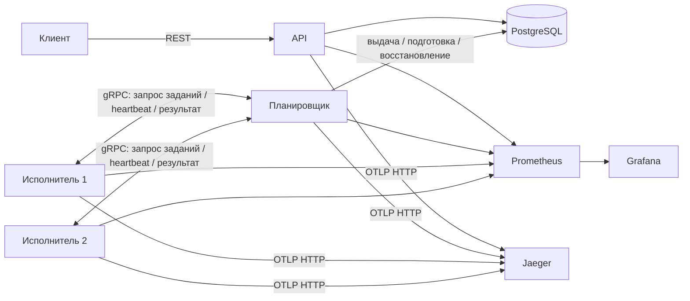
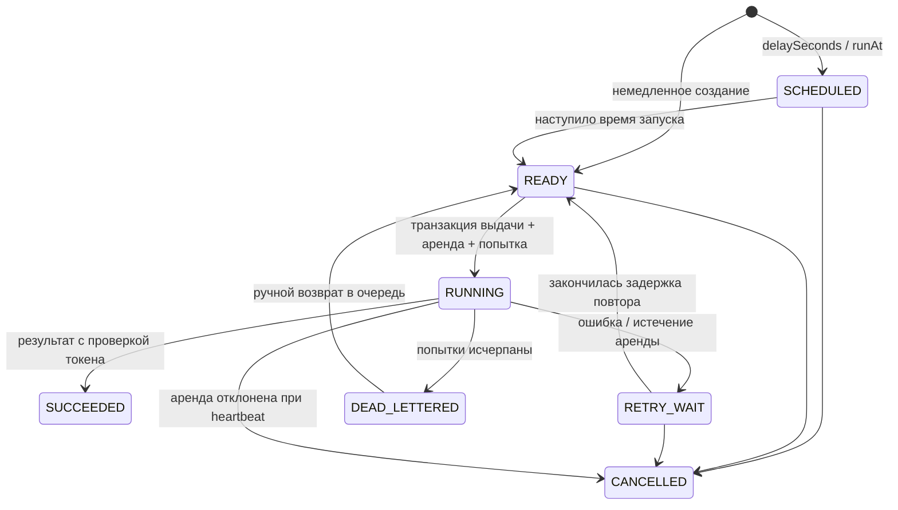

# Распределённая платформа обработки фоновых заданий

Инфраструктурный проект на Go: REST API, планировщик с очередью в PostgreSQL и отдельные исполнители, взаимодействующие через gRPC. Основные механизмы обработки реализованы самостоятельно: транзакционное получение заданий, ограничение параллелизма, продлеваемые аренды, защита от устаревших исполнителей, повторные попытки со случайным разбросом задержек, отмена и очередь неисправимых заданий.



Исполнители не подключаются к PostgreSQL. База данных одновременно служит надёжным хранилищем очереди и источником истины. Несколько планировщиков могут обслуживать исполнителей без выбора лидера.

## Быстрый запуск

Требуется Docker с Compose. Для демонстрации не нужно устанавливать Go, protoc или базу данных на хосте.

```sh
docker compose up --build -d --wait
curl http://localhost:8080/health/live
curl http://localhost:8080/health/ready
curl -H 'Authorization: Bearer local-demo-api-key' \
  -H 'Content-Type: application/json' -H 'Idempotency-Key: example-1' \
  -d '{"type":"sleep","payload":{"durationMs":1000},"priority":10,"maxAttempts":3}' \
  http://localhost:8080/api/v1/jobs
```

В PowerShell используйте `curl.exe` или `Invoke-RestMethod` с хеш-таблицей заголовков. Подставьте полученный UUID:

```sh
curl -H 'Authorization: Bearer local-demo-api-key' http://localhost:8080/api/v1/jobs/UUID
curl -H 'Authorization: Bearer local-demo-api-key' http://localhost:8080/api/v1/jobs/UUID/attempts
curl -X POST -H 'Authorization: Bearer local-demo-api-key' http://localhost:8080/api/v1/jobs/UUID/cancel
curl -H 'Authorization: Bearer local-demo-api-key' http://localhost:8080/api/v1/dead-letter
curl -X POST -H 'Authorization: Bearer local-demo-api-key' http://localhost:8080/api/v1/jobs/UUID/requeue
```

Для демонстрации повторных попыток создайте задание `unstable` с `{"failureProbability":1}` и `maxAttempts:2`. Обработчик `http_request` разрешает GET/HEAD только для явно заданного списка доменов, проверяет результаты DNS, подключается к проверенному IP-адресу и отклоняет перенаправления и обращения к частным сетям.

| Сервис | Локальный адрес |
|---|---|
| API | http://localhost:8080 |
| Проверка состояния и метрики планировщика | http://localhost:8081 |
| Grafana | http://localhost:3000 (admin / local-demo-admin) |
| Prometheus | http://localhost:9091 |
| Jaeger | http://localhost:16686 |

Grafana автоматически настраивает панель **Distributed Job Platform** и источники данных Prometheus/Jaeger. PostgreSQL доступен внутри сети Compose. Команда `docker compose down` сохраняет том с данными. Демонстрационные учётные данные являются общедоступными примерами: замените `API_KEY`, `WORKER_TOKEN` и учётные данные PostgreSQL/Grafana для своего окружения. По умолчанию все методы API требуют аутентификации с Bearer-токеном; проверки состояния и метрики предназначены для внутренней эксплуатации. Опубликованные порты привязаны к локальному интерфейсу loopback. В демонстрационной сети gRPC работает без шифрования; для внешнего развёртывания требуется TLS/mTLS или частная сеть с аутентификацией.

## Жизненный цикл и надёжность



Состояние `RUNNING` включает задания, принятые в ограниченную локальную очередь исполнителя. Таким образом объединены LEASED и RUNNING: аренда и попытка начинаются при выдаче, а тайм-аут обработчика — при фактическом выполнении. Подробнее — в [описании жизненного цикла](docs/job-lifecycle.md).

Получение заданий использует `SELECT … FOR UPDATE SKIP LOCKED`, сортировку по убыванию приоритета и FIFO при одинаковом приоритете. Короткая транзакция блокирует подходящие строки, назначает новый токен и создаёт запись попытки. Конкурирующие планировщики пропускают заблокированные строки. Блокировка строки исполнителя обеспечивает соблюдение его допустимого количества незавершённых заданий между экземплярами планировщика; транзакции не охватывают сетевые RPC-вызовы.

Каждый heartbeat продлевает только ещё действующие аренды с правильными исполнителем и токеном. Исчезновение исполнителя не оставляет задания навсегда зависшими: процесс восстановления отмечает попытки как `EXPIRED` и назначает повтор или перевод в DLQ. Состояние задания и история попыток изменяются атомарно. Отмена немедленно снимает аренду, а следующий heartbeat сообщает исполнителю о необходимости отменить контекст. Устаревший результат не может отменить решение об отмене задания или завершить новую попытку.

**Доставка как минимум один раз (at-least-once) не означает выполнение ровно один раз (exactly-once).** Обработчик может выполнить внешнее действие и завершиться аварийно до подтверждения результата. Тогда задание будет выполнено повторно. Идемпотентность создания обеспечивается `UNIQUE(queue,idempotency_key)` и возвратом существующего задания при повторном ключе; внешние действия это не дедуплицирует. Обработчикам нужны уникальные ключи задания или бизнес-операции, идемпотентный внешний API либо транзакционный outbox. Повторный ключ возвращает исходное задание даже при отличающемся теле нового запроса. Подробнее — в [описании гарантий надёжности](docs/reliability.md).

Повторы используют экспоненциальную задержку с верхним пределом и равномерным случайным разбросом в диапазоне `[0.5 * delay, delay]`. Ручной возврат в очередь сбрасывает текущий лимит попыток и сохраняет всю историю. Успешные и отменённые задания нельзя вернуть в очередь. Повышение приоритета по мере ожидания и предотвращение бесконечного ожидания низкоприоритетных заданий оставлены для следующих этапов.

## Параллелизм и завершение работы

Каждый исполнитель управляет N горутинами выполнения и очередью из Q элементов. Он сообщает не более `N + Q - active` свободных мест, а PostgreSQL независимо ограничивает число назначенных незавершённых заданий значением N + Q. Мьютекс защищает активные контексты, индексированные токенами; атомарные переменные хранят готовность; канал передаёт задания на выполнение. Обработчики перехватывают паники и используют предельное время выполнения контекста. Heartbeat отклоняет конкретные токены, поэтому старая попытка не может отменить новую.

SIGINT/SIGTERM прекращают получение новых заданий. Принятые задания завершаются, пока heartbeat продолжает продлевать аренды; по истечении `SHUTDOWN_TIMEOUT` оставшаяся работа отменяется. Повторная отправка результата сохраняет завершённый результат в памяти и не запускает обработчик заново. Аварийно завершённый процесс теряет эту память и восстанавливается через истечение аренды в БД. Обработчики должны реагировать на отмену контекста. Подробнее — в [описании параллелизма](docs/concurrency.md).

## Разработка и проверки

Используются Go 1.26+, PostgreSQL 17, pgx, net/http, protobuf/gRPC, slog, Prometheus и OpenTelemetry. Переменные окружения описаны в [.env.example](.env.example); Go не загружает `.env` автоматически. Compose читает `.env` для подстановок, например `API_KEY`.

```sh
go test ./...
go vet ./...
go test -race ./...
go test -race -tags=integration -count=1 ./tests/...
go test -run='^$' -bench=. -benchmem ./internal/...
python3 scripts/smoke.py
python3 scripts/failure-demo.py
```

Интеграционные тесты используют Testcontainers и требуют запущенного Docker. Они проверяют гонку 100 запросов с одним ключом идемпотентности, конкурентное получение через SKIP LOCKED, ограничения загрузки исполнителя, исчерпание попыток, восстановление аренды, отклонение устаревшего результата, отмену, приоритеты и курсорную пагинацию. Проверка через настоящий gRPC transport охватывает аутентификацию, ограниченные пакеты крупных заданий и предел расширения данных при нормализации JSONB. Модульные тесты проверяют валидацию, переходы состояний, управляемую случайность, ограничение параллелизма, корректное завершение, тайм-аут контекста, удалённую отмену и повторную отправку результата. CI запускает детектор гонок, интеграционные тесты, линтер, сборку и сквозную проверку всей системы.

В Windows без компилятора C детектор гонок можно запустить в тестовом образе:

```sh
docker build --target test -t job-platform-tests -f deployments/docker/Dockerfile .
docker run --rm job-platform-tests
```

Для повторной генерации protobuf используйте protoc 33.0, `protoc-gen-go v1.36.11` и `protoc-gen-go-grpc v1.6.1`. Сгенерированный код уже включён в рабочее дерево, поэтому обычной сборке protoc не нужен. Команда `make proto` обновляет этот код. Изменения БД выполняются явными версионированными миграциями; одноразовый сервис migrate применяет их перед запуском API и планировщика.

## Наблюдаемость и производительность

Структурированные JSON-логи содержат идентификаторы запроса, задания и исполнителя, номер попытки, очередь, тип и длительность; содержимое заданий в логи не выводится. API сохраняет контекст трассировки W3C; выдача задания планировщиком и выполнение исполнителем продолжают трассу создания. gRPC также инструментирован через OpenTelemetry. Сохранённые метаданные связывают отдельные RPC-запросы в долгоживущую трассу задания.

Метки метрик ограничены событиями, маршрутами, статусами и методами RPC; идентификаторы заданий, запросов и пользователей не используются как метки. В [описании наблюдаемости](docs/observability.md) приведены запросы панели и область действия счётчиков. pprof по умолчанию выключен; при включении требуется явный локальный IP-адрес loopback. См. [нагрузочное тестирование и профилирование](docs/load-testing.md), [результаты замеров](docs/performance-results.md) и [сценарии отказов](docs/failure-scenarios.md).

## Структура и архитектурные решения

`cmd/{api,scheduler,worker}` явно собирают зависимости. `internal/domain` определяет контракты и правила состояний; `internal/repository/postgres` отвечает за изменения, сохраняемые в БД; `internal/api` обрабатывает REST; `internal/scheduler` реализует RPC и обслуживание очереди; `internal/worker` управляет обработчиками и выполнением; `internal/transport/pb` содержит сгенерированный protobuf; `internal/runtime` запускает и связывает компоненты процессов; `deployments` настраивает наблюдаемость.

[Архитектура](docs/architecture.md), [база данных](docs/database.md), [OpenAPI](docs/openapi.yaml), [protobuf](proto/worker/v1/worker.proto) и [архитектурные решения ADR](docs/decisions/001-postgres-queue.md) описывают компромиссы и эксплуатационные ограничения. Это ориентированное на эксплуатацию ядро портфолио-проекта; изоляция арендаторов, завершение TLS-соединений, хранение и архивирование истории, повышение приоритета по времени ожидания и транспорт на основе брокера относятся к настройке развёртывания или следующим этапам.
